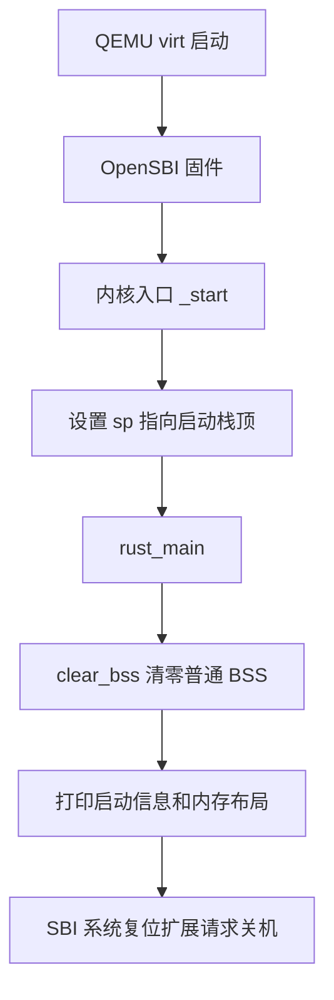

# CH01：首次判题复盘与启动代码说明

日期：2026-10-11

## 当前结果与记录范围

本次用户反馈“已经成功通过提交”。首次失败日志和截图已核对；本记录未附最新成绩单，因此不填写未经核对的最终分数。本文说明此次提供的修正版，GitHub 中位于 `minchos_kernel/`；学校仓库中对应目录为 `os/`。两处目录名称不同，不能直接用 GitHub 项目覆盖整个学校仓库。

## 一、第一次为什么失败

首次被评测的提交为 `b684a561c04872a38876de40b7a422f08df8d900`。日志表明 release 编译完成，生成了 9242 字节的镜像，但评分为 0/25。截图确认两个独立评分项失败：

| 评分项 | 当时结果 | 原因与修正 |
| --- | --- | --- |
| 零告警编译 | 0/10 | 14 条 `direct cast of function item into an integer` 警告。将链接符号的 `as usize` 改为 `as *const () as usize`，包括清零函数及所有段边界。 |
| 内核接管、BSS 清零及串口输出 | 0/15 | 未检测到“内核已进入 S 态”、“.bss 已清零”、“内核内存布局：”。修正输出文字，按 UTF-8 字节发送字符串。 |

“编译成功”和“零告警评分通过”是不同条件。普通编译允许 warning，但平台的评分项不允许。修复警告不应通过屏蔽 lint 完成，而应明确表达取地址的意图：

```rust
// 链接脚本提供的是地址符号；这里取地址，不调用它。
let start = sbss as *const () as usize;
let end = ebss as *const () as usize;
```

输出不匹配也不能仅靠添加字符串掩盖：代码必须先建立栈、实际清零 BSS，再打印成功信息。`console.rs` 使用 `s.bytes()`；`chars()` 返回 Unicode 码点，将码点当单字节发送会破坏中文编码。截图只证明判据未匹配，没有保存当时完整串口输出，因此无法仅凭它断定缺失文字完全由乱码造成。

日志中的 `detached HEAD` 是判题机检出指定提交时的正常状态，不是本次失分原因。

## 二、后续提交为什么又被拒绝

网页终端无法输入后，改用 GitLab Web IDE 编辑文件，并执行 Commit & Push to ch01。随后在线工作区推送出现：

```text
! [rejected] HEAD -> ch01 (non-fast-forward)
```

原因是 GitLab 分支已经包含 Web IDE 的新提交，在线工作区尚未整合这些提交。Git 拒绝可能丢失远端历史的更新；这不是 Rust 编译错误，也不是代码被删掉。

后续应先确认远端分支、工作区修改和提交历史，再同步；不应使用强制推送覆盖修正版。GitLab 提交完成和学校判题完成也是两个步骤，是否自动触发判题取决于学校平台实现。现有日志只证明判题服务克隆指定提交、构建、评分，不能证明它一定由 GitLab Webhook 或某种 CI Runner 触发。

此次用户最终反馈提交已成功，具体同步操作未在本会话中提供，本文不补写不存在的操作记录。

## 三、当前代码总体思路

目标是接通“固件交接 → 建立运行条件 → 输出 → 关机”这条最小启动链。



### 1. 构建配置：告诉编译器生成哪种程序

`Cargo.toml` 的包名是 `os`，所以生成的 ELF 文件名也是 `os`。`.cargo/config.toml` 指定 `riscv64gc-unknown-none-elf`，并将 `src/linker.ld` 传给链接器。应进入内核目录再执行 Cargo，确保该目录的配置被读取。

`#![no_std]` 表示不用依赖宿主操作系统的 Rust 标准库，但仍能使用 `core`。`#![no_main]` 取消普通程序的默认入口，由汇编 `_start` 接管。`global_asm!` 将启动汇编包含进内核。

### 2. linker.ld：为代码和数据安排地址

链接脚本把内核放在当前启动方案约定的 `0x80200000`，并把 `.text.entry` 放在最前面。该地址服务于本实验的启动配置，不是所有 RISC-V 系统都必须使用的固定地址。

| 区域 | 用途 |
| --- | --- |
| `.text` | 可执行指令 |
| `.rodata` | 只读数据，如输出字符串 |
| `.data` | 有初始值的可写静态数据 |
| 启动栈 | 函数调用时保存临时数据等 |
| 普通 `.bss` | 需要初始化为零的静态数据 |

`stext`、`etext` 等符号由链接器提供，Rust 使用它们计算范围。段之间按 4 KiB 对齐，当前输出的部分大小包含对齐填充；`size / 1024` 是整数除法，会舍去不足 1 KiB 的部分。

### 3. entry.asm：先把栈准备好

```asm
_start:
    la sp, boot_stack_top
    call rust_main
```

栈预留 `4096 * 16`，即 64 KiB。先让栈指针指向栈顶，再调用 Rust 入口，Rust 的函数调用才有可用的栈。

这不是整台机器上电执行的第一条指令；此前 QEMU 启动代码和 OpenSBI 已经运行。

### 4. clear_bss：给静态变量建立正确初值

`clear_bss()` 遍历半开区间 `[sbss, ebss)`，通过 `write_volatile(0)` 逐字节清零。安全性依赖链接脚本正确提供可写范围，`unsafe` 并不自动保证地址正确。

链接脚本先安排 `.bss.stack`，再定义 `sbss`，因此清零范围不包含正在使用的启动栈。否则清零过程可能破坏自己的返回地址和局部数据。

### 5. console.rs 与 sbi.rs：把文字交给固件输出

输出路径是：

```text
println! → format_args! → console::print
         → Stdout.write_fmt → write_str
         → UTF-8 bytes → console_putchar → ecall → OpenSBI
```

`Stdout` 实现 `core::fmt::Write`，因此能使用 Rust 的格式化能力。`write_str` 每次发送一个 UTF-8 字节，保持中文编码完整。

`sbi_call` 用寄存器传参：`a0` 至 `a2` 是参数，`a6` 是功能号，`a7` 是扩展号。`ecall` 将服务请求交给固件处理。本实现用 Legacy Console Putchar（扩展号 `0x01`）输出字符，用 SRST 扩展请求关机。

本实验选择通过 SBI 输出，并不意味着 S 态永远不能访问硬件；能否直接访问具体设备还取决于权限和映射。

### 6. rust_main：组织启动流程

入口依次执行：

1. 清零普通 BSS。
2. 打印标识和启动状态。
3. 输出 `.text`、`.rodata`、`.data`、`.bss`、启动栈的地址范围。
4. 使用 `ekernel - skernel` 计算总内存跨度。
5. 请求关机，结束本章演示。

`-> !` 表示函数不会正常返回。`lang_items.rs` 则提供 panic 处理器，打印错误位置和信息后请求关机。

## 四、如何验证和提交

在本 GitHub 仓库中：

```bash
cd minchos_kernel
cargo build --release
cargo rustc --release -- -D warnings
```

安装对应 RISC-V Rust 目标后可编译。`make run` 还需要 GNU Make、QEMU、rust-objcopy 及其 LLVM 工具支持；当前 Makefile 会先生成二进制镜像，再用 ELF 启动 QEMU。

在学校课程仓库根目录中：

```bash
make grade CH=1 FORMAT=json
cat score.json
```

学校的评分脚本不在本 GitHub 仓库中，不能在这里直接运行上述 grade 命令。提交时核对分支为 `ch01`，并确认判题使用的是最新提交编号。GitHub 的 `main` 是项目归档分支，不等同于学校判题分支。

本次本地编译与将 Rust 警告视为错误的构建检查通过；启动器出现的路径规范化提示与 Rust 源码 warning 分开记录。未在本机重跑 QEMU，也未获取最新平台成绩单。

## 五、当前边界

这份代码完成第一章启动骨架，还没有实现完整微内核、进程调度或地址空间管理。输出横幅中的 SV39 不是已启用分页的证据，当前入口没有设置页表和 satp。

当前 SBI 关机失败时会 panic，而 panic 处理器又请求关机，存在失败路径递归的局限；此处如实记录，未在已提交教学实现上扩大功能修改。后续扩展时可增加无递归的停机兜底和多核启动管理。
